<a href="https://flow-hackathon.onpratiks.com">
  <picture>
    <source media="(prefers-color-scheme: dark)" srcset="docs/images/banner-dark.webp">
    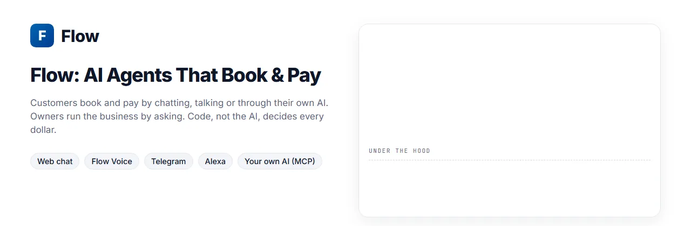
  </picture>
</a>

# Flow

<p>
  <a href="https://flow-hackathon.onpratiks.com"></a>
  <a href="https://youtu.be/2pcu9kMpHTI"></a>
  <a href="https://devpost.com/software/flow-5c6mis"></a>
  <a href="https://flow-hackathon.onpratiks.com/systemmap"></a>
  <a href="#the-hackathon-edition"></a>
  
  
  
  <a href="LICENSE"></a>
</p>

**An AI booking agent for small businesses, paid with PayPal.** Customers book and pay by chatting, talking, or through their own AI assistant. Owners run the business by asking. PayPal moves every dollar, and code, not the AI, decides how much.

I built Flow on my own for the [PayPal AI Hackathon 2026](https://paypalaihackathon.devpost.com/). **[Flow on Devpost](https://devpost.com/software/flow-5c6mis)**: the story, the 3-minute video and the gallery.

**▶ [Live demo](https://flow-hackathon.onpratiks.com)**: no sign-up. This is the **hackathon edition**: each visitor gets a private copy of a small demo city in Austin, TX, with PayPal sandbox money ([what that means](#the-hackathon-edition)).<br>
**▶ [Interactive system map](https://flow-hackathon.onpratiks.com/systemmap)**: hover any part for its endpoints and code, or follow one booking from the first message to the refund.<br>
**▶ [The film](https://youtu.be/2pcu9kMpHTI)**: Flow in 3 minutes, from a missed call to a refund by policy.

<p align="center"><a href="https://youtu.be/2pcu9kMpHTI"></a></p>

**Contents:** [Why I built Flow](#why-i-built-flow) · [A day with Flow](#a-day-with-flow) · [Under the hood](#one-booking-under-the-hood) · [Try it](#try-it-in-3-minutes) · [Hackathon edition](#the-hackathon-edition) · [By the numbers](#by-the-numbers) · [What Flow does](#what-flow-does) · [Payment governance](#payment-governance-built-in) · [PayPal](#paypal-used-for-real-sandbox) · [Sponsor tools](#sponsor-tools-used-for-real) · [Architecture](#architecture) · [The money path](#the-money-path) · [Deep dives](#engineering-deep-dives) · [Challenges](#technical-challenges-i-solved) · [Channels](#channels-i-chose-and-the-ones-i-didnt) · [Proud of](#what-im-proud-of) · [Learned](#what-i-learned) · [Next](#whats-next) · [Built with](#built-with) · [Run it locally](#run-it-locally) · [Built during the hackathon](#built-during-the-hackathon)

## Why I built Flow

### Saturday at Willow & Co.

*A made-up Saturday at the demo's salon. The numbers under it are real.*

Ana runs Willow & Co., a two-chair salon in Austin. By mid-morning she's halfway through a colour, foils in both hands, and her phone has rung three times. She can't pick up. One of those callers wanted a haircut this afternoon; by the time Ana calls back, they've booked somewhere else.

At 2:00 her next client doesn't come. At 2:20 she stops waiting. The chair stays empty until 3, and that hour can't be sold again.

That evening Ana does the admin. She sends a deposit link to Monday's new client (not paid yet) and works out whether last week's late cancellation gets half the deposit back or none of it. Then a message arrives that no person typed: a customer asked their AI assistant to "book my usual haircut for Saturday", and the assistant is trying to do it.

<p align="center">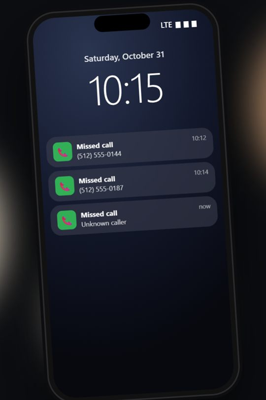</p>

### What one empty chair costs

| A salon with… | |
|---|---|
| 20 bookings a day at $40 | $800 of work a day |
| 15–30% of bookings that never show, without a deposit | 3 to 6 empty chairs a day |
| a 20% no-show rate | **$160 lost a day, about $4,000 a month** (25 working days) |

Late cancellations do the same damage, just with a few hours' warning. Asking for payment up front cuts no-shows by roughly **30–70%**, according to industry and vendor reports ([Bookeo](https://www.bookeo.com/news/2026/02/reduce-salon-no-shows-proven-strategies-actually-work/), [Shortcuts / The Salon Magazine](https://shortcutssoftware.com/the-1-way-to-cut-salon-no-shows-by-up-to-70/), [SchedulingKit](https://schedulingkit.com/statistics/appointment-deposit-statistics)). So why doesn't Ana take deposits?

### Because a deposit is a second job

| To take a deposit, someone has to… | When Ana can do it |
|---|---|
| answer the call or the DM | between clients, if at all |
| send a payment link and chase it | in the evening |
| hold the slot until it's paid, and free it if it isn't | never: the slot just stays "pencilled in" |
| refund the right amount when someone cancels | with a calculator and the policy page |
| answer a PayPal dispute ("I never booked this") | by digging through old texts |

Booking apps can take deposits, but only from customers who come to the app. Ana's customers call, text, DM, and now send their AI.

### The new question: who may spend money when an AI is in the loop?

The message that no person typed is the new part. The hard problem is no longer *can an AI fill in a booking form?* It's ***who is allowed to move money when an AI is in the loop?***
- **The customer** won't hand an AI a blank cheque.
- **The business** can't let a model improvise a refund.
- **When a payment is disputed,** someone has to show exactly what was agreed, and who agreed to it.

### The rules I built Flow on

I wanted to build something that answers that question properly, so for this hackathon I built Flow on five rules:

1. **Meet the customer where they are.** One engine behind every door: web chat, Flow Voice, Telegram, Alexa and the customer's own AI.
2. **Payment is part of the booking.** There's no paying at the visit: a priced service is paid in full, or by the deposit the business sets, when it's booked. The seat is held while PayPal takes the money, so a confirmed booking always has its payment, or its deposit, already in.
3. **Code decides money, never the AI.** The AI talks and picks tools. Prices, refunds and spending limits come from code and from the business's own policy, and anything that moves money is quoted first.
4. **The customer stays in charge of their AI.** Their AI pays without asking only inside an allowance they signed. Every charge tells PayPal who started it, and above the allowance only the customer's own click approves.
5. **Show the work.** Every AI step, seat hold and PayPal call appears on a live timeline. A judge, an owner or a customer can see exactly why money moved, and a dispute reply is drafted from the booking's own record.

### Why PayPal

Those rules need a payment partner that already has the pieces an AI booking agent needs, and PayPal has each one:

| What Flow needs | What PayPal provides |
|---|---|
| No card form and no sign-up | The customer logs in with the PayPal account they already have |
| Every later booking paid with one "yes" | Vault saves PayPal after that login |
| To tell PayPal who started each charge | Vault's stored-credential flags, sent on every saved-PayPal charge |
| The owner side on the same rails | Policy refunds through Payments, a paid invoice per booking through Invoicing, and dispute replies through Disputes |

## A day with Flow

The same Saturday, with Flow. The screens are the live demo, with PayPal sandbox money; the phone shots are from the demo film.

**Before work: a voice note from the car.** A customer sends Flow on Telegram a voice note: "Book a beard trim tomorrow at five." Flow books it at Eastside Barber Co., pays the $18 with their saved PayPal because it fits the AI allowance they set, and answers with a voice note too, in the customer's language, with the transcript underneath. They never look at the screen.

<p align="center">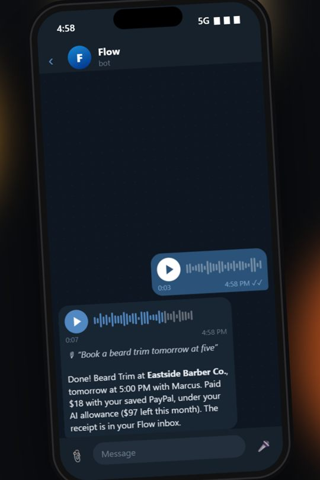</p>

**Mid-morning: one "yes" pays.** "Book my usual haircut for Saturday afternoon." Flow knows the usual is Ana at Willow & Co., the customer picks 3 PM, and Flow quotes the salon's own price, $40. The customer says "Yes, book it" and it's paid and confirmed, with the receipt in their inbox. They logged in with PayPal once, and PayPal saved the account for one-step payments after that.

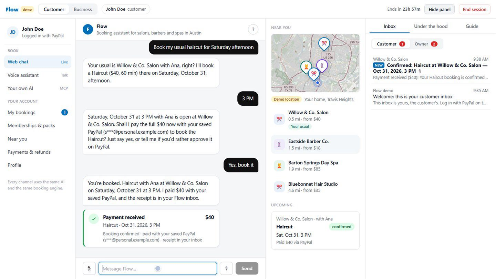

**"Like this."** A customer sends a photo of the cut they want. Flow attaches it to the booking, so Ana sees the picture itself on her calendar, not a guess at what was meant.

**Early afternoon: Ana keeps cutting.** Her phone isn't ringing. It's showing bookings that are already paid, because the chat, Flow Voice, Telegram, Alexa and the customer's own AI all book into the same calendar, and each one pays before it's confirmed.

<p align="center">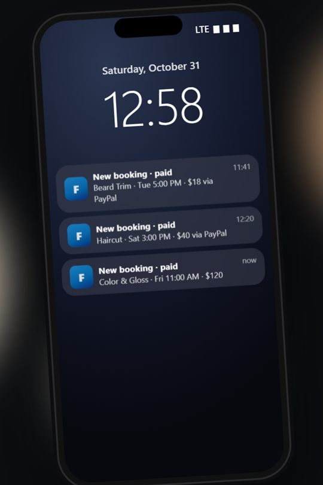</p>

**Evening: a cancellation, refunded by policy.** A customer cancels. Flow works out the refund from Willow & Co.'s own policy (cancel early, get more back), tells the customer the amount, and refunds through PayPal only after they agree. The AI never picks the number. Here the cancellation came early enough for a full refund: $40 in, $40 back, both in Ana's PayPal ledger.

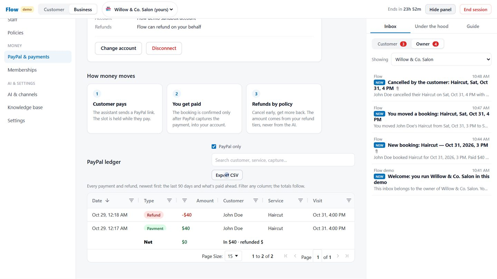

**Late at night: the customer's own AI books, within limits.** The customer asks Claude, connected to Flow, to book a men's cut and a beard trim for Tuesday. Both fit the AI allowance the customer set in Flow, so Claude pays for both on its own and lists the receipts. Anything above the allowance, like a $120 colour, it can't pay: the customer gets an **Approve in Flow** card and decides.

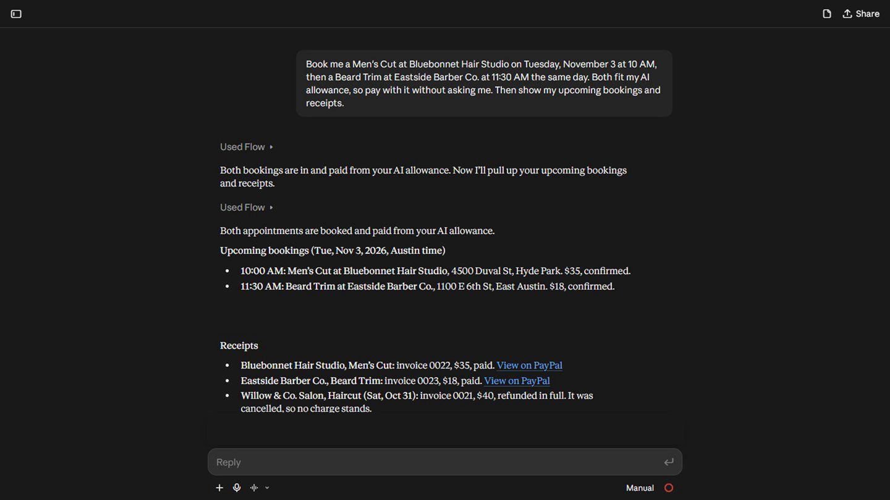

**Two weeks later: "I never booked this."** A PayPal dispute arrives. Flow drafts the reply from the booking's own record: who asked, on which channel, what price was quoted, and when they said yes. Ana reads it and sends it.

**Every step, in the open.** Under the hood shows each AI step, seat hold and PayPal call as it happens. Customer names show there only as tokens like `⟦pii:K7QX2M9P⟧`, because Flow's AI never sees them ([how that works](docs/PRIVACY_TOKENS.md)).

**Sunday morning: Ana asks her own AI how the week went.** She connected Claude to Flow for Business. It answers from Flow's records and checks PayPal live: 9 paid bookings, $410 collected, $70 refunded, $340 net. When she asks it to block lunch over a booking, it doesn't: it tells her about the clash first.

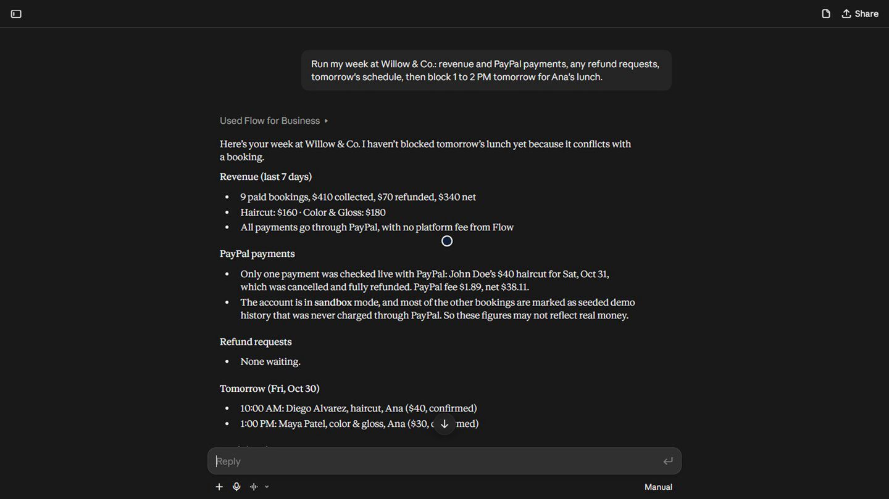

### Ana's Saturday, before and after

| | Before | With Flow |
|---|---|---|
| A call during a colour | Missed | The chat, Telegram, Alexa or the customer's AI books it |
| The deposit | A link sent at night, often unpaid | Paid in the same conversation, after one "yes" |
| The slot | "Pencilled in" until paid | Held 10 minutes while PayPal takes the money, then confirmed |
| A late cancellation | Worked out by hand | Quoted from the policy, refunded by code |
| A customer's AI | No way in | Books and pays inside a limit the customer set |
| A dispute | Digging through texts | A reply drafted from the booking's own record |

### How Flow differs

| | A booking app with deposits | A general AI assistant with your card | Flow |
|---|---|---|---|
| Where customers can book | Its own page or app | Anywhere it can browse | Chat, voice, Telegram, Alexa and the customer's own AI, into one calendar |
| Who sets the price and the refund | The business | The AI, from what it reads | The business's policy, in code |
| Limits on an AI spending money | Not built for AI | Whatever the card allows | An allowance the customer sets, checked in code |
| Proof for a dispute | The booking record | A chat history | Every step on a timeline, and a drafted reply |
| Customer names and the AI | n/a | The AI sees everything | Flow's AI sees tokens only |

## One booking, under the hood

Every booking, on any channel, leaves the same trail on the **Under the hood** timeline, live, step by step:

```text
Channel   the customer asks to book          web chat · Flow Voice · Telegram · Alexa · their own AI (MCP)
AI        Claude Haiku 5.5 picks the tools   skipped when the customer's own AI calls Flow over MCP
Tool      check_availability                 real free slots, in the business's own time zone
Tool      book_appointment                   quotes the business's price; the AI can't change it
Channel   the customer says yes              or the AI allowance they signed covers it, checked in code
Seat      held for 10 minutes                DynamoDB conditional write: no one else can pay for that slot
PayPal    payment                            saved PayPal in one step, or an approve link
                                             PayPal Server SDK (APIMatic), with a PayPal-Request-Id
Booking   exactly-once claim                 conditional delete, then the booking is written
PayPal    paid invoice                       Invoicing v2
Inbox     receipt                            to the customer and to the owner
Channel   confirmation                       back the way the booking came
later     PayPal webhook                     signature verified, run once per event
```

On the live demo, a booking with saved PayPal takes about 10 seconds from the customer's yes to the paid invoice. Whichever channel it came from, it then shows on the owner's calendar and in the PayPal ledger.

## Try it in 3 minutes

1. Open the [demo](https://flow-hackathon.onpratiks.com) and press **Start the guided demo** (about 5 minutes, with tips) or **Explore on my own**.
2. **Log in with PayPal** using the sandbox buyer shown on screen. It's fake money, and PayPal saves the account so later bookings pay after a yes.
3. In the web chat, ask **"Book me a haircut"**, pick a time and say yes to the price. Open **Under the hood** to watch each AI step, the seat hold and the PayPal payment.
4. Switch to **Business**: the booking is on the calendar and in the PayPal ledger, and both inboxes have the receipt.
5. Back on **Customer**, ask to cancel. Flow quotes the refund from the salon's policy and refunds it only after you say yes.

Telegram, Alexa and your own AI app (Claude, ChatGPT, Cursor) are in the customer menu, and each uses the same session.

## The hackathon edition

I built Flow for real salons, barbers and spas, and the engine is ready for that: each business connects its own PayPal account and is paid directly. Taking it to real businesses is the next step, and it's one I can't complete on my own within a hackathon. A real launch goes through each platform's standard onboarding:
- **PayPal:** joining as a partner platform, so every business can connect its own PayPal account, then moving from sandbox to live keys.
- **Amazon:** publishing the Alexa skill through certification.
- **Meta:** business verification and app review for WhatsApp, Instagram and Messenger.
- **LINE:** a LINE Official Account.

These are the usual steps for any product that handles real bookings and payments, and they're next on Flow's roadmap.

So what's running is the **hackathon edition**: the whole product, with real AI and real PayPal sandbox payments, in a demo city where nothing costs anyone real money.

| | In the hackathon edition | For real businesses |
|---|---|---|
| **Money** | PayPal **sandbox** only: fake money, with a shared sandbox buyer shown on screen. Payments land in Flow's sandbox PayPal account. | Live PayPal, each business paid straight into its own PayPal account |
| **The city** | A demo city in Austin, TX, with seeded businesses (Willow & Co. Salon, Eastside Barber Co., Barton Springs Day Spa and more), customers and bookings. You're a customer living in Travis Heights; Flow never uses your real location. | Real businesses signing up, near the customer's real location |
| **Sessions** | A private copy of the city per visitor, for 24 hours. **End session**, or the 24 hours running out, wipes everything. | Accounts that last |
| **Logins** | Customers log in with PayPal (sandbox). There are no owner logins: from the same session you can switch to the owner of any business in the city. | An owner account per business |
| **Messages** | Confirmations, receipts and refund notes go to a web inbox in the session, one for the customer and one for the owner. No email is sent. | The customer's own email or chat app |
| **Alexa** | A development skill with a beta test (judges add their Amazon email on the Alexa page), linked to your session with a 4-digit code | A published skill with standard account linking (Log in with PayPal once) |
| **Your own AI (MCP)** | Links made for your session, which stop working when it ends | Links tied to each account |
| **Fair-use limits** | Per session per hour: 40 chat turns, 5 checkouts, 10 files, 150 MCP calls and 8 setup calls. Across the demo: 3,000 AI calls a day. | Limits per plan |
| **Hosting** | AWS `us-east-1` (Lambda, API Gateway, DynamoDB, S3) as a dev stage, and Vercel for the dashboard | A production stage with monitoring |

## By the numbers

| | |
|---:|---|
| **5** | customer channels on one engine: web chat, Flow Voice, Telegram, Alexa and your own AI over MCP |
| **9** | PayPal products in use, all in the sandbox |
| **23 + 47** | AI tools: 23 for customers, 47 for owners over MCP (everything the dashboard does) |
| **532** | backend tests in 62 suites |
| **~$0.03** | AI cost per demo run, down from about $0.25 |
| **0** | amounts the AI can set: prices, refunds and limits all come from code |

## What Flow does

**For customers** (web chat, Flow Voice in the browser, a store's Telegram bot, an Alexa skill, or their own AI app over MCP):
- "Book my usual": Flow knows past visits, finds the nearest places, checks real availability and books.
- **Pay with PayPal.** Logging in with PayPal saves the account, so every booking pays in one step after a yes. With an **AI spending allowance** the customer sets (say, up to $50 a booking and $150 a month, for 30 days, at salons), their AI can pay without asking each time, within limits code enforces.
- Memberships and packs paid from the saved PayPal, cancellations and refund requests. Refunds follow the business's own policy.
- Photos, PDFs and voice notes ("here's my doctor's note about an allergy") go onto the booking for the business. Flow replies in the customer's language.
- **Their own AI books for them:** each session has an MCP link for Claude, ChatGPT, Cursor or VS Code that can find, book, pay, move, cancel and ask for refunds, under the same rules as every channel ([Payment governance](#payment-governance-built-in)).

**For owners** (dashboard, or their own AI app over MCP):
- Set the business up from a description and documents. AI drafts the services, prices, staff, hours and refund rules, and the owner approves.
- A **calendar that follows PayPal**, where a held seat turns into the booking when PayPal captures it, and a **PayPal ledger** with totals and CSV export ([Sponsor tools](#sponsor-tools-used-for-real)). Drag a booking to move it, and the customer is told.
- Refund any amount or by policy, collect the rest of a deposit, answer refund requests. Paid PayPal invoices are issued for every booking.
- **Disputes answered from the booking's own record:** the AI drafts the reply, and it goes to PayPal only when the owner sends it.
- **"What Flow did for you"**: bookings made without the owner, money paid before the visit, and money the policy kept on no-shows.
- **Run it from their own AI:** the owner's MCP link covers everything the dashboard does: the schedule (with what PayPal says about each payment), prices, staff, refunds, disputes, PayPal reports, and setting the business up from its documents.

## Payment governance, built in

> **Flow is payment governance for small businesses in the age of AI agents: every dollar moves by rules written in code, every step is recorded, and when a payment is challenged, the evidence is already written.**

Big companies have finance teams, approval chains and audit logs. A three-chair salon has none of that, and now its customers' AI assistants want to book and pay on their own. Every business that takes money has to answer three questions: **who may move money, how much, and can you prove what happened?** Flow answers all three in code, so the owner doesn't have to.

### Six rules on every payment

| Stage | The rule | How code enforces it | Code | Tests |
|---|---|---|---|---|
| **Who may pay** | Only the customer's yes, or an allowance they signed. Over MCP, an AI can never approve its own payment. | The allowance is HMAC-signed and checked on every charge. Above it, the payment waits for the customer's click on Flow's approval page. | `core/allowance.js`, `core/approvals.js`, `mcp/sessionServers.js` | `allowance`, `approvals`, `mcpElicitation`, `mcpApprovalUrl` |
| **How much** | Prices come from the business, and refunds from its own policy tiers. | The amount the AI passes must match the quote, or nothing is charged. | `core/refunds.js`, `services/tools.js` | `refunds`, `refundRequests` |
| **How often** | Every payment and refund happens exactly once, even with retries. | A `PayPal-Request-Id` on every write, a conditional-delete claim before a booking is written, and each webhook event run once. | `services/payments/paypal.js`, `core/paymentConfirm.js`, `handlers/paypal.js` | `paypalSdk`, `paymentConfirm`, `paypalWebhooks`, `seatHold` |
| **Who started it** | PayPal is told on every saved-PayPal charge. | `stored_credential`: `CUSTOMER` after the customer's yes; `MERCHANT` with `UNSCHEDULED_PREPAID` and the signed mandate's ID under the allowance. | `core/paymentFlow.js` | `paypalSdk` |
| **What happened** | Every step is recorded as it happens. | A per-session timeline of AI steps, tools, seat holds, PayPal calls, policy maths and messages, redacted before it's stored. | `services/trace.js` | `trace`, `traceDynamo` |
| **When it's challenged** | The evidence is already there, and the owner decides. | A dispute is linked to its booking, drafted from the booking's facts only, and sent with a PDF only after the owner's OK. | `core/disputes.js` | `disputes` |

**The same rules on every channel.** Web chat, Flow Voice, Telegram, Alexa and MCP all call the same booking and payment tools, so all six rules apply everywhere. The one difference is who says yes:
- On web chat, Flow Voice, Telegram and Alexa, the customer is talking to Flow directly, so their own yes counts.
- Over MCP, a third-party AI sits in between, so its yes doesn't count. Above the allowance, the customer approves in Flow.

Code paths are under `apps/lambda/src/`, and the tests are the matching `*.test.js` files in `apps/lambda/src/__tests__/`. Each rule has a deep dive with its code in [Engineering deep dives](#engineering-deep-dives).

### Who decides what

- **Flow's code decides** who may start a payment, how much it is (from the business's own prices and policy), and when money moves: only after a quote and a yes, or inside the signed allowance.
- **PayPal decides** what PayPal always decides: whether a payment goes through, and how a dispute ends. Flow gives PayPal what it needs to decide well: who started each charge, risk data from the web chat, and a factual record when a payment is challenged.
- **The owner decides** anything that needs judgment: sending a dispute response, accepting a claim, refunding outside the policy, and approving the setup the AI drafted.
- **The AI decides nothing about money.** It talks, picks tools and drafts, and code checks everything it asks for.

### The security behind it

- PayPal webhooks are accepted only with a valid PayPal signature, and each event runs once.
- With live keys, Flow never collects anyone's money into its own account: each business connects its own PayPal.
- **Flow's books are checked against PayPal's.** The owner's AI (`paypal_payments`, `paypal_payment`) looks up each booking's order at PayPal and compares what Flow says was paid and refunded with what PayPal says, and names any booking that doesn't match. The PayPal fee and the net to the business come from PayPal's own breakdown on the capture, not from Flow's maths (`core/ownerPaypal.js`, `services/payments/paypal.js`).
- Before anything is stored, the timeline drops every field named like a token, secret, password, authorization header, API key, cookie or one-time code, and masks email addresses.
- Each store's Telegram bot checks a secret header on every update, and bot tokens stay on the server.
- The Alexa function answers only Flow's own skill.
- MCP links belong to one session and stop working when it ends, and fair-use limits cap chat turns, checkouts, files and AI calls.

## PayPal, used for real (sandbox)

| PayPal product | What Flow does with it |
|---|---|
| **Orders v2** | Approve → re-check the seat → capture, so a slot taken while paying is never charged. Exactly-once confirmation. |
| **Payments (refunds)** | Policy refunds on cancel, partial refunds, automatic full refund if a paid booking can't be made. |
| **Vault v3 (save payment methods)** | Save PayPal when the customer logs in, pay in one step later, Change account / Remove. Memberships and packs are paid from it, and monthly memberships renew from it. Each charge carries `stored_credential` and PayPal risk data. |
| **Subscriptions** | Monthly memberships at a business paid into its own PayPal account. |
| **Invoicing v2** | A paid invoice per booking, with payments and refunds recorded on it. |
| **Log in with PayPal** | The customer signs in with their PayPal sandbox account and books under its name. |
| **Partner Referrals** | "Connect your PayPal" for a business's own account. |
| **Disputes** | Cases linked to their booking; an AI-drafted response with the booking record attached, sent on the owner's OK; accept a claim; sandbox decisions to test. |
| **Webhooks** | Signed events for payments, refunds, reversals, pending captures, disputes and removed saved accounts (deployed only). |

**Built on PayPal's server SDK, generated by APIMatic:** see [APIMatic](#apimatic-paypals-money-path-on-the-generated-sdk) below for what moved and what it adds.

## Sponsor tools, used for real

### Bryntum Scheduler: the calendar follows PayPal

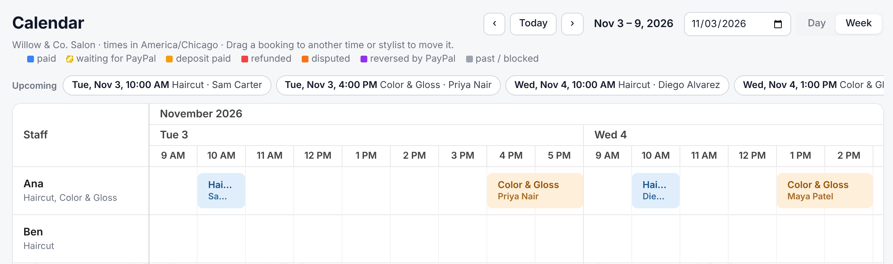

*The owner's calendar on the live demo. Each bar's colour is its PayPal state; the legend sits above the grid.*

- **Staff are rows, bookings are bars**, and every bar shows its PayPal state: paid, **waiting for PayPal** (striped while the seat is held), deposit paid, refunded, disputed, reversed by PayPal, or past and blocked time.
- **It follows PayPal live.** While a seat is held for a payment, the calendar checks every 4 seconds, so the striped bar turns into the booking as soon as PayPal captures the money. Otherwise it refreshes every 15 seconds, so a booking from any channel appears without a reload.
- **Drag to move, checked by the server first.** Dropping a bar asks Flow's API before Bryntum commits the move. It only sticks if that stylist does the service and is free, and the customer is told in their inbox.
- **The salon's clock, not the viewer's.** Times are the business's local wall-clock times, so the calendar shows the salon's hours wherever the owner is.
- Hovering a bar shows how it was booked and whether it was moved. A disputed bar opens its dispute when clicked, and a customer's reference photo sits in the bar's corner.

```js
// apps/dashboard/app/dashboard/calendar/SchedulerView.js
onBeforeEventDropFinalize={({ context }) => {
  context.async = true                          // Bryntum waits for Flow's answer
  const ev = context.eventRecord
  const resource = context.newResource || context.resourceRecord
  onMove({ bookingId: ev.id, startLocal: toLocal(context.startDate), resourceId: resource?.id })
    .then(ok => context.finalize(!!ok))         // yes: the move sticks
    .catch(() => context.finalize(false))       // no: the bar snaps back
}}
```

### AG Grid: every table the owner works in

<p align="center">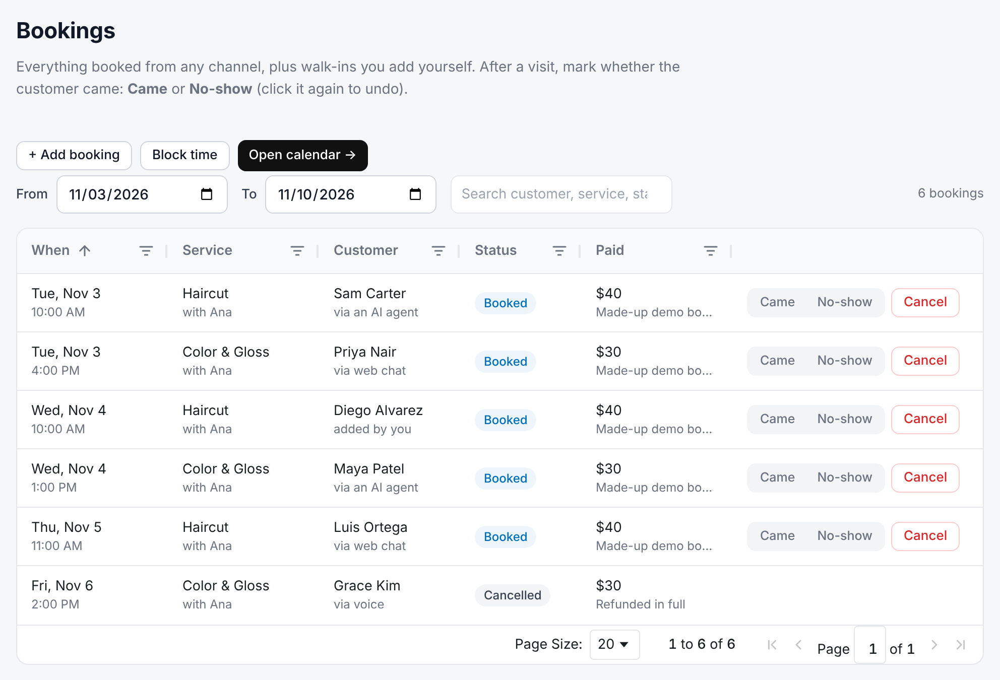</p>

*The Bookings table on the live demo: bookings from every channel, with Came, No-show and Cancel on each row.*

- **One shared grid component** (`apps/dashboard/lib/Grid.js`) runs 8 tables: bookings, the PayPal ledger, services, staff, memberships, knowledge-base answers, setup, and the Overview's "Coming up".
- **The PayPal ledger** has date and number filters on its columns, a quick search across customer, service and capture ID, and totals in a pinned bottom row that follow the filters. It also exports to CSV and pages by 15, 50 or 100 rows.
- **Bookings** can be sorted and filtered on any column, and each row has Came, No-show and Cancel.

### APIMatic: PayPal's money path on the generated SDK

I moved orders, captures, refunds, saved PayPal and memberships onto [`@paypal/paypal-server-sdk`](https://www.npmjs.com/package/@paypal/paypal-server-sdk), which APIMatic generates from PayPal's API specs. I set it up with the **APIMatic Context Plugin for PayPal**. Every SDK step shows `via: PayPal Server SDK (APIMatic)` on the Under the hood timeline.

Both ways talk to the same PayPal APIs. The SDK is PayPal's official way to call them from Node, and it moves several checks earlier, into the code itself:

| | My own REST calls (before) | PayPal's server SDK, generated by APIMatic (now) |
|---|---|---|
| Request fields | Checked by PayPal's API when the request arrives | Also checked by the SDK before the request is sent (`ArgumentsValidationError`) |
| Operation and header names | Typed by hand in Flow's code | Named operations and parameters from PayPal's own API spec |
| OAuth token | Flow's own caching code | The SDK's built-in token manager |
| Timeouts | None set in my code | One setting for every call |
| API updates | Each call edited by hand | Upgrade one pinned package |
| Tests | Faked network calls | The SDK's test hook, checking the exact JSON PayPal receives |

**Good to know:** the SDK adds about 19 MB to the Lambda package and about 0.14 s to load, once per container. It covers Orders, Payments, Vault and Subscriptions; for the other PayPal APIs Flow uses, it keeps its own REST calls (see below).

**What the Context Plugin changed.** Its skills, taken from the SDK's own source, changed real decisions:
- **Timeout.** The SDK lets each app choose its timeout. Following the plugin, Flow sets 15 seconds, so a slow call can't use up the Lambda's 29.
- **Retries.** Flow retries only reads. Writes carry a `PayPal-Request-Id` instead, so a retried capture or refund can't run twice.
- **One client per container,** which caches the OAuth token.

Invoicing, Disputes, Log in with PayPal, Partner Referrals and webhook checks run through Flow's own REST calls to the same PayPal APIs. There are no new keys: it's the same PayPal sandbox app, and Flow never calls APIMatic while it runs. Before-and-after code and the full list: [docs/APIMATIC.md](docs/APIMATIC.md).

## Architecture

<a href="https://flow-hackathon.onpratiks.com/systemmap">
  <picture>
    <source media="(prefers-color-scheme: dark)" srcset="docs/images/system-map-dark.png">
    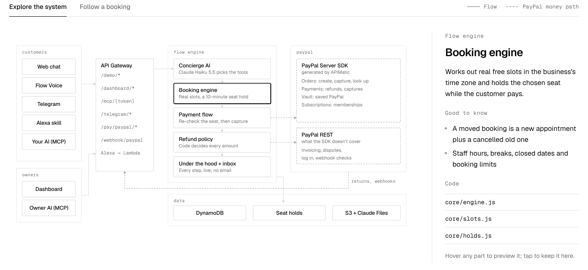
  </picture>
</a>

I built every channel as a thin adapter: a message comes in, the same AI and tools run, a reply goes out. No channel has its own booking or payment logic, so adding one never touches the money path.

<details>
<summary>Text version (Mermaid)</summary>

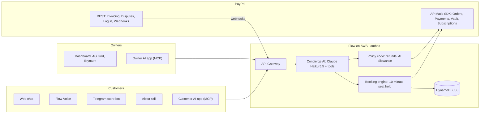

</details>

## The money path

What happens between "book me a haircut" and the receipt, with a customer who has saved PayPal:

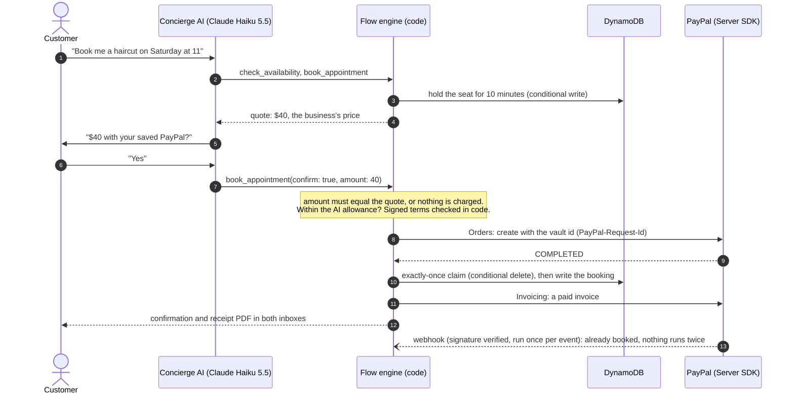

A customer without saved PayPal gets an approve link instead; when PayPal sends them back, Flow re-checks the seat before capturing, and refunds in full if the booking still can't be made.

## Engineering deep dives

Longer guides: [Channels](docs/CHANNELS.md) · [Connect your own AI (MCP)](docs/MCP.md) · [Privacy tokens](docs/PRIVACY_TOKENS.md) · [APIMatic and the PayPal SDK](docs/APIMATIC.md)

<details open>
<summary><b>1. Money moves exactly once</b></summary>

Lambda retries, a customer double-tapping the return link, and PayPal's webhook can all try to finish the same order. Three guards make that safe.

**First**, every PayPal write carries a `PayPal-Request-Id`, so PayPal itself returns the first result:

```js
// services/payments/paypal.js
async function capture(providerOrderId) {
  try {
    const order = await sdk.run('orders.captureOrder', () => sdk.orders().captureOrder({
      id: providerOrderId,
      paypalRequestId: `cap_${providerOrderId}`,
      prefer: 'return=representation'
    }))
    return captureFromOrder(order)
  } catch (err) {
    if (err.code === 'ORDER_ALREADY_CAPTURED') return getOrder(providerOrderId)
    throw err
  }
}
```

**Second**, only one path may turn the payment into a booking: the pending payment is claimed with a conditional delete, and whoever loses returns the winner's result.

```js
// core/paymentConfirm.js (trimmed)
const consumed = await consumePendingPayment(providerOrderId)   // conditional delete
trace.event('db', consumed ? 'Exactly-once claim won (conditional delete)' : 'Exactly-once claim lost — other path is booking it', …)
if (!consumed) return (await getResult(resultKey(providerOrderId))) || { status: 'processing' }
```

**Third**, at the door: PayPal retries a webhook until it gets a 200, so each event is checked for its signature, then recorded as processed, and a repeat is skipped:

```js
// handlers/paypal.js
if (!(await paypal.verifyWebhook(event.headers, rawBody))) return { statusCode: 401, body: 'invalid signature' }
const eventKey = `pp:${body.id}`
if (await processedMessages.hasProcessed(eventKey)) return { statusCode: 200, body: 'ok' }
await handleEvent(body)
await processedMessages.markProcessed(eventKey)   // not marked → PayPal retries it later
```

I checked the first two against the live PayPal sandbox with `scripts/paypal-sandbox-e2e.js`: a retried capture returns the same capture, and a retried refund the same refund.
</details>

<details>
<summary><b>2. The AI can't pick an amount</b></summary>

The model never computes money. Prices come from the business's services, and the amount the AI passes on `confirm: true` is only checked against the quote: if it differs, nothing is charged and the customer is quoted again. Refunds come from the business's refund tiers:

```js
// core/refunds.js (trimmed)
function quoteRefund(appointment, refundTiers, now = Date.now()) {
  const refundable = Math.max(0, round2(paid - already))
  const hoursUntil = (new Date(appointment.startTime).getTime() - now) / 3_600_000
  // the first tier the cancellation still qualifies for; no tiers = full refund; after the start = nothing
  tier = tiers.find(t => hoursUntil >= t.hoursBefore) || null
  pct = tier ? tier.refundPct : 0
  return { refundable, pct, amount: round2(refundable * pct / 100), hoursUntil: round2(hoursUntil), tier }
}
```

Paying without asking is only possible inside the **AI spending allowance**, which the customer sets and the AI can't change. The terms are HMAC-signed, and every payment is checked against them in code:

```js
// core/allowance.js (trimmed)
if (!verify(customer.customerId, a)) return refuse("on terms that don't match the signed mandate")
if (a.expiresAt && Date.parse(a.expiresAt) <= Date.now()) return refuse('after your AI mandate ended')
if (amount > a.perBooking + 0.004) reason = `over your ${formatMoney(a.perBooking)} per-booking limit`
else if (amount > left + 0.004) reason = `over what's left of your monthly allowance`
if (reason) return refuse(reason, { spent, left })
```

Each payment under the allowance is written down and signed before the charge; deep dive 3 shows what PayPal is told.
</details>

<details>
<summary><b>3. The customer's own AI can pay, but never approve itself</b></summary>

A customer's own AI (Claude, ChatGPT, Cursor) connects to Flow over MCP and calls the same booking and payment tools as Flow's web chat. That raises the real agentic-commerce question: what stops an AI from approving its own payment?

- **Over MCP, the AI's own `confirm: true` isn't the customer's yes.** A payment goes through only inside the AI spending allowance the customer signed (deep dive 2), or after the customer's own click.
- **Above the allowance, nothing is charged.** Flow stores a pending approval for 15 minutes, puts **Review and approve** in the customer's Flow inbox, and hands the AI a link it can show but not use.
- **If the AI app can open pages, Flow asks it to.** When an app connects, it tells Flow whether it supports MCP's URL elicitation. If it does, Flow answers the tool call with an elicitation, and the app opens the approval page for its user:

```js
// mcp/sessionServers.js (trimmed)
const r = await executeTool(name, args || {}, ctx)
// A payment waiting for the customer's click: an app that can open pages
// for us gets the standard URL elicitation; any other app shows the link.
if (r?.needsApproval && await opensPages(session, conn?.sessionId)) {
  throw new RpcError(ERR.URL_ELICITATION_REQUIRED, 'This payment needs your approval in Flow.', {
    elicitations: [{ mode: 'url', elicitationId: r.approvalId, url: r.approvalUrl, message: `Approve ${formatMoney(r.amount, r.currency)} …` }]
  })
}
```

- **Retries and double clicks are safe.** The same request from a retrying AI reuses the same approval (its key is a hash of the tool, the booking and the amount). The approve click is claimed once, then runs the same tool with the approved amount, down the same money path as web chat.
- **PayPal is told who started each charge.** A payment the customer approved goes with `stored_credential` initiator `CUSTOMER`. One under the allowance goes as `MERCHANT` with usage `UNSCHEDULED_PREPAID`, and the signed mandate's ID on the order (`core/paymentFlow.js`).

More, including how to connect each AI app: [Connect your own AI (MCP)](docs/MCP.md).
</details>

<details>
<summary><b>4. Beating Alexa's 8-second clock</b></summary>

Alexa gives a skill about 8 seconds to answer. Booking and paying (think, check, hold, charge, invoice) can take longer, and the first version booked fine but Alexa showed "Skill response was marked as failure". Now the AI turn runs in an asynchronous run of the same Lambda: answered within 6 seconds, Alexa replies as usual; longer, Alexa says "I'm on it" and the next turn gets the answer. One turn at a time per Alexa user, so nothing is booked twice.

```js
// core/alexa.js (trimmed)
if (vr.type === 'say' && vr.text) {
  await progressive(event, 'One moment.')                  // Alexa speaks while the AI works
  const job = { id: crypto.randomUUID(), sid: session.sid, env }
  if (await startWork(job)) {                              // InvokeCommand, InvocationType: 'Event'
    const r = await waitForResult(job.id, REPLY_WITHIN_MS()) // 6 s
    if (r) return spoken(r)
    await store().putKey(pendingKey(who), 'P', { id: job.id, at: Date.now() }, Date.now() + RESULT_TTL_MS)
    return say(ON_IT, { reprompt: GO_ON })                 // "I'm on it… say go on"
  }
}
```
</details>

<details>
<summary><b>5. Under the hood: every step traced, with nothing passed around</b></summary>

Every step on the timeline (AI calls, tools, seat holds, PayPal, policy maths, bookings, inbox messages, webhooks) is written by the module that did it, deep in the call chain, without a logger being passed around:

```js
// services/trace.js: how the rest of the code uses it
await trace.run(`sess:${session.sid}`, async () => { … })     // opens the session's scope
trace.event('redis', 'Seat held', { unit, expiresIn: 600 })      // from anywhere below it
await trace.span('paypal', 'Capture', () => capture(id), r => ({ status: r.status }))
```

- **The scope rides the async call chain** with Node's `AsyncLocalStorage`, so a PayPal call five modules down still lands on the right session's timeline.
- **No scope, no cost.** Outside a demo session every call is a no-op, so unit tests and other traffic are untouched.
- **Nothing is lost when Lambda freezes.** Writes go out without blocking the request, and they're all awaited when the scope closes, because Lambda freezes once the response is sent.
- **Redacted before it's stored** (see [The security behind it](#the-security-behind-it)), so the timeline is safe to show a judge.
- **Cheap to watch.** Events live in DynamoDB for 24 hours, and the panel polls with a cursor, so it only ever fetches what's new.
</details>

<details>
<summary><b>6. Claude reads less, so it costs less</b></summary>

I set Flow up so Claude only ever reads what it needs: speech arrives as text, documents arrive as text where possible, and anything read twice comes from cache.

| Input | Where | Limit | How Flow processes it | What Claude reads |
| --- | --- | --- | --- | --- |
| Chat messages | Web chat, Telegram, Alexa, Flow Voice, MCP | 40 turns per session per hour | Claude Haiku 5.5 at low effort; the system prompt, tools and conversation are cached; the time rides on each message so the cache holds | Cached prompt plus the new message; replies capped at 4,096 tokens, thinking included |
| Voice notes (WAV, OGG, MP3, AAC, FLAC) | Web chat, Telegram | 1 minute | Transcribed by Groq's Whisper, with Gemini as backup | The transcript only, never the audio |
| Live speech | Flow Voice, Alexa | — | Recognised by the browser or by Alexa; Flow Voice replies are spoken by Amazon Polly | Text only |
| Photos (JPG, PNG, WebP, GIF) | Web chat, Telegram | 4 MB | Read once; a short summary goes on the booking, and the picture itself is kept in S3 for the owner | One image read per photo |
| PDFs | Web chat, Telegram | 4 MB | Read once and summarised onto the booking | One document read |
| Word, Excel, text, CSV | Web chat, Telegram | 4 MB | Text is pulled out on Flow's server with no AI, up to 30,000 characters (Excel: 2,000 rows, 50 columns) | Text only |
| Knowledge base (PDF, Word, Excel, text, photo) | Owner: Knowledge base, setup | 10 MB | Stored once in Claude's Files API. A PDF with real text is kept as text with page marks; a scan stays a PDF; a photo is read once and kept as text | The business's documents, cached: about 3,300 tokens a question from cache. As text, the demo FAQ costs 336 tokens a question instead of 1,867 |

- **I gave each job to the cheapest service that does it well:** Claude for the thinking, Groq for transcripts, Polly for speech, the browser for live recognition. That took a demo run from about $0.25 to about $0.03.
- **Backups only before a tool runs:** if Haiku fails before it has acted, Sonnet 5.5 answers instead, so nothing runs twice.
- **Hard demo limits** cap the spend (listed in [The hackathon edition](#the-hackathon-edition)).
</details>

<details>
<summary><b>7. Disputes answered from the booking's own evidence</b></summary>

When a customer disputes a payment with PayPal, a small business usually has to dig through messages and screenshots to answer. In Flow, the booking itself is the evidence, and PayPal's Disputes API carries it.

- **Linked automatically.** A `CUSTOMER.DISPUTE.*` webhook (or a sync of open cases) fetches the case from PayPal and links it to its booking through the capture ID. The booking's bar is flagged on the calendar, and the owner gets a message in their inbox.
- **Facts, not a story.** Flow turns the booking into plain facts, with nothing inferred:
  - when and how it was booked (web chat, Alexa, an AI agent…);
  - what was paid, and whether the customer's AI paid it under the mandate they signed;
  - the cancellation policy shown before paying, and the customer's own note;
  - whether the booking was moved, and whether the visit happened or was marked a no-show;
  - any refund.
- **Claude drafts from those facts only.** The prompt forbids anything that isn't in them. If the AI fails, a plain template built from the same facts takes over.
- **Code picks PayPal's evidence type,** and never claims the service was delivered when it wasn't:

```js
// core/disputes.js
function evidenceType(rec, a) {
  if (Number(a?.refundAmount) > 0) return 'PROOF_OF_REFUND'
  if (rec.reason === 'CREDIT_NOT_PROCESSED' || rec.reason === 'CANCELED_RECURRING_BILLING') return 'RETURN_POLICY'
  // A no-show wasn't served: the policy and the record speak for it, not proof of service.
  if (rec.reason === 'MERCHANDISE_OR_SERVICE_NOT_RECEIVED' && a?.status !== 'no_show' && a?.status !== 'cancelled'
      && (a?.status === 'completed' || Date.parse(a?.endTime || '') < Date.now())) return 'PROOF_OF_FULFILLMENT'
  return 'OTHER'
}
```

- **Nothing goes to PayPal without the owner.** Sending asks for the owner's OK first. Then Flow attaches the facts as a one-page PDF and calls PayPal's provide-evidence endpoint. Accepting the claim, which refunds the customer, asks first too.

```js
// core/disputes.js send() (trimmed)
if (!confirm) return { needs_confirmation: true, message: … }      // the owner's OK first
if (!rec.practice) {
  const pdf = await timelinePdf(business, rec, lines)              // the facts, as a one-page PDF
  await paypal().provideDisputeEvidence({ disputeId, evidenceType: type, notes: text, pdf })
}
```

- **Testable in the sandbox.** PayPal's sandbox has no API to open a dispute (the buyer opens one in PayPal's Resolution Center). So the owner can open a **practice case** on a paid booking: it's drafted the same way, labelled as practice everywhere, and never sent. The sandbox's require-evidence and adjudicate actions move a real sandbox case along.
</details>

### Reference

<details>
<summary><b>How a booking moves through the code</b></summary>

<a href="https://flow-hackathon.onpratiks.com/systemmap">
  <picture>
    <source media="(prefers-color-scheme: dark)" srcset="docs/images/system-map-booking-dark.png">
    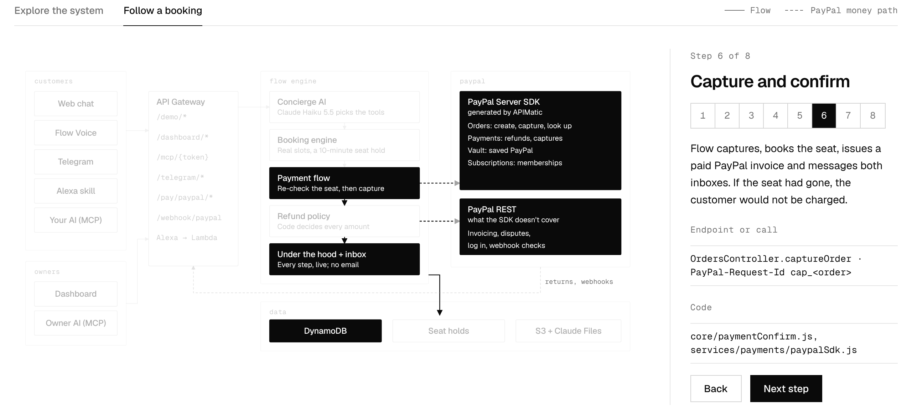
  </picture>
</a>

*Step 6 of 8 in the map's* Follow a booking *view. The parts in use are highlighted; the PayPal money path is dashed.*

1. **The customer asks** ("Book my usual haircut for Saturday") on any channel: `POST /demo/chat` (web chat), `POST /demo/voice` (Flow Voice), `POST /telegram/bot/{botId}` (a store's bot), the Alexa skill (which invokes its Lambda directly), or `/mcp/{token}` (their own AI app).
2. **The concierge AI picks tools.** `core/concierge.js` builds the prompt; Claude Haiku 5.5 calls `search_businesses`, `check_availability` and `book_appointment` (`services/tools.js`).
3. **The seat is held.** `book_appointment` holds the slot for 10 minutes (a DynamoDB conditional write; Redis if one is set up) and quotes the price. With saved PayPal and a yes, or inside the AI allowance, Flow pays at once (`OrdersController.createOrder` with the vault id). Otherwise it creates a PayPal order and sends the approve link.
4. **PayPal sends the customer back** to `GET /pay/paypal/return`. `core/paymentConfirm.js` re-checks the seat, then captures (`OrdersController.captureOrder`, request id `cap_<order>`). If the seat is gone, the customer isn't charged; if the booking fails after capture, they're refunded in full.
5. **Everything updates at once:** the booking, a paid PayPal invoice, both inboxes (customer and owner), the calendar, the ledger and the Under the hood timeline.
6. **PayPal confirms by webhook** (`POST /webhook/paypal`, signature verified): captures, pending payments, refunds, reversals, disputes and removed saved accounts.
7. **A cancel** is priced by the business's refund tiers (`core/refunds.js`), quoted, and refunded only after a yes (`PaymentsController.refundCapturedPayment`).
</details>

<details>
<summary><b>API endpoints</b></summary>

| Route | Called by | What it does |
| --- | --- | --- |
| `POST /demo/session`, `GET`/`DELETE /demo/session` | The demo home page | Starts, reads or ends a private demo city (24 hours) |
| `POST /demo/chat`, `POST /demo/voice` | Web chat, Flow Voice | One assistant turn (text, photos, PDFs, voice notes) |
| `GET /demo/trace`, `GET /demo/inbox` | Under the hood, the inboxes | The live timeline; customer and owner messages |
| `POST /demo/login/paypal`, `POST /demo/allowance` | Customer profile | Log in with PayPal (and save it); set the AI spending allowance |
| `GET /demo/mcp`, `GET /demo/alexa`, `GET /demo/telegram` | Set it up, Alexa, Telegram pages | The session's MCP links, Alexa code, Telegram links |
| `/dashboard/*` | The owner dashboard | Bookings, calendar, payments, disputes, knowledge base, memberships, services, staff, settings, stats |
| `/mcp/{token}` | The customer's or owner's own AI app | MCP servers (Streamable HTTP); a payment above the AI allowance waits for the customer's click on Flow's approval page |
| `GET /pay/paypal/return`, `/cancel`, `/status`, `/vault/return`, `/membership/return`, `/login/return` | PayPal redirects | Finish a payment, saved PayPal, membership or login |
| `POST /webhook/paypal` | PayPal | Signed payment, refund, dispute and vault events |
| `POST /telegram/webhook`, `POST /telegram/bot/{botId}` | Telegram | Updates for Flow's demo bot and each store's bot (secret header) |
| Alexa skill (direct Lambda) | Amazon Alexa | Voice requests from Echo devices and the Alexa app |
</details>

## Technical challenges I solved

The hard part wasn't calling PayPal. It was making sure money moves exactly once, and only when it should, while an AI is in the loop. Every fix is enforced in code.

| Challenge | How I solved it |
| --- | --- |
| A seat taken while the customer pays | A 10-minute seat hold, a re-check before capture, and a full refund if the booking still fails ([The money path](#the-money-path)) |
| Retries charging or refunding twice | Request IDs on every PayPal write, a conditional-delete claim, and webhooks run once ([deep dive 1](#engineering-deep-dives)) |
| An AI deciding money | Prices and refunds come from code, and money moves only after a yes, inside a signed allowance, or after the customer's own click ([deep dives 2 and 3](#engineering-deep-dives)) |
| Reply time | Alexa waits about 8 seconds and API Gateway 29 (serverless was my choice: it costs nothing at rest and scales per visitor). A fast model with cached prompts, and a background run for long Alexa turns ([deep dive 4](#engineering-deep-dives)) |
| Weekday and time-zone mistakes | The model once turned "Saturday" into the wrong date. Now the prompt lists the coming week's dates to look up, never compute, and slots use the business's own time zone |
| AI cost | The cheapest path for each kind of input, under hard demo limits ([deep dive 6](#engineering-deep-dives)) |

## Channels I chose, and the ones I didn't

I planned a far bigger ecosystem, then decided to cut it to what a judge can really use. I kept **Telegram** and **Alexa** because both allow a real bot for free: Telegram through BotFather, Alexa through a development skill with a beta test. **WhatsApp, Instagram and Messenger** need Meta's business verification first ([The hackathon edition](#the-hackathon-edition)). **LINE** is one of the most used chat apps in Asia, especially in Japan, Taiwan and Thailand; with the demo city in Austin it didn't fit this edition, but it's a natural next channel for businesses in Asia. I didn't fake any of them with look-alike chat skins. How each channel works: [Channels](docs/CHANNELS.md).

## What I'm proud of

- **A customer's own AI can pay, and never approve itself** ([deep dive 3](#engineering-deep-dives)).
- **Exactly-once money, checked against the live PayPal sandbox,** not just in tests ([deep dive 1](#engineering-deep-dives)).
- **One engine, five channels:** a booking from any of them lands on the owner's Bryntum calendar, in the AG Grid PayPal ledger and in both inboxes at once.
- **Disputes answered from evidence,** with the owner always deciding ([deep dive 7](#engineering-deep-dives)).
- **The money path on PayPal's generated SDK,** with no new keys ([APIMatic](#apimatic-paypals-money-path-on-the-generated-sdk)).

## What I learned

- **AI and money need a hard wall.** Letting the model talk and pick tools, but never compute an amount, made every money bug a normal code bug I could test.
- **Voice platforms run on a clock.** Alexa's 8 seconds don't care how fast your server is; long work has to be asynchronous from the start.
- **Models are bad at calendars.** Dates should be looked up, not worked out by the model.
- **A generated SDK moves checks earlier.** With PayPal's server SDK, a missing or wrongly typed field is caught in Flow before the request is even sent. My own REST calls (Invoicing, Disputes) rely on their own tests for that.
- **Cost is routing.** Where each input goes (Claude, Groq, Polly or the browser) decides most of the bill.

## What's next

- A phone line, so a customer can just call.
- Checking the whole PayPal account with Transaction Search, on top of today's check of each booking against its own PayPal order.
- Type-checking every PayPal request against PayPal's spec at build time.
- Bringing the same generated-SDK approach to Invoicing and Disputes with APIMatic.
- The platform onboarding for a real launch: PayPal as a partner platform with live keys, the Alexa skill published, and WhatsApp, Instagram, Messenger and LINE ([The hackathon edition](#the-hackathon-edition)).

## Built with

| Tool | Where |
| --- | --- |
| **PayPal** | Orders, Payments, Vault, Subscriptions, Invoicing, Log in with PayPal, Partner Referrals, Disputes, Webhooks (sandbox) |
| **APIMatic** | PayPal's generated server SDK for the money path, set up with the APIMatic Context Plugin ([details](docs/APIMATIC.md)) |
| **AG Grid** | PayPal ledger, bookings, services, staff, memberships, knowledge-base answers |
| **Bryntum Scheduler** | The owner's calendar, which follows PayPal (held, paid, deposit, refunded, reversed) |
| **Claude** | Haiku 5.5 for the agent and its tools, Sonnet 5.5 as backup, Files API for the knowledge base |
| **Groq, Amazon Polly** | Groq's Whisper hears voice notes; Polly speaks Flow Voice replies |
| **AWS, Vercel** | Lambda, API Gateway, DynamoDB, S3; the Next.js dashboard on Vercel |
| **Telegram, Alexa, MCP** | The channels beyond web chat and Flow Voice |
| **Leaflet, OpenStreetMap** | The map of nearby businesses |

### Repository layout

```text
apps/
  lambda/                    Node 22 backend on AWS Lambda (CommonJS, Jest)
    src/core/                business logic: bookings, payments, refunds, allowance, memberships, voice, Alexa
    src/services/            AI tools, Claude, PayPal (SDK + REST), DynamoDB, inbox, Under the hood trace
    src/handlers/            HTTP routes: demo, dashboard API, PayPal returns and webhooks, Telegram, Alexa
    src/mcp/                 the customer and owner MCP servers
    src/__tests__/           532 Jest tests
    scripts/                 deploy packaging, key checks, PayPal sandbox end-to-end test, Alexa skill push
  dashboard/                 Next.js 16: the demo, the owner dashboard (AG Grid, Bryntum), the system map
docs/                        guides (channels, MCP, privacy tokens, APIMatic, keys), the Alexa skill package, README images
```

## Run it locally

You need Node 22, a PayPal **sandbox** app, AI API keys, and AWS credentials (bookings live in DynamoDB tables). Keys and where to get them: [docs/KEYS.md](docs/KEYS.md).

```bash
npm install
cp apps/lambda/.env.example apps/lambda/.env               # fill in the keys
cp apps/dashboard/.env.local.example apps/dashboard/.env.local
node apps/lambda/scripts/check-keys.js                    # checks every key, prints no secrets
node apps/lambda/scripts/local-api.js                     # API on http://localhost:4000
npm run dev --workspace=apps/dashboard                    # app on http://localhost:3000
```

Tests: `npx jest` in `apps/lambda` (532 tests).

## Built during the hackathon

**Before the hackathon,** Flow was an idea and early code for salons in India: WhatsApp, Instagram and LINE adapters, Indian languages, UPI payments, GST invoices, sync with other booking software, and a booking engine on AWS. It never worked end to end for a real booking, and it had no payment layer an AI agent could use safely.

**During the hackathon** (from Oct 1, 2026), I built:
- the whole payment layer on PayPal: the nine products above, the signed AI allowance and policy refunds, so code, not the AI, decides every amount;
- the agent, rebuilt on Claude with 70 tools (23 for customers, 47 for owners);
- every channel in this edition: web chat, Flow Voice, Telegram, Alexa, and both MCP servers;
- the owner dashboard with Bryntum Scheduler and AG Grid, the money path on APIMatic's generated PayPal SDK, the Under the hood timeline and the demo city;
- the film, the logo and the images.

| | Lines of backend JavaScript |
|---|---|
| The pre-hackathon snapshot (commit `1809b63` in my working repo) | about 7,600 |
| Changed during the hackathon (346 commits, 422 files) | about +51,400 / −3,900 |

This public repo is a clean copy of the result. Its two commits don't carry that history: my working repo, which starts from the pre-hackathon snapshot, is private. I removed the pre-hackathon code this edition doesn't use (WhatsApp, Cashfree, GST invoices, the Indian phone line and the booking-software imports, about 5,000 lines) before publishing.

## License

[MIT](LICENSE)
